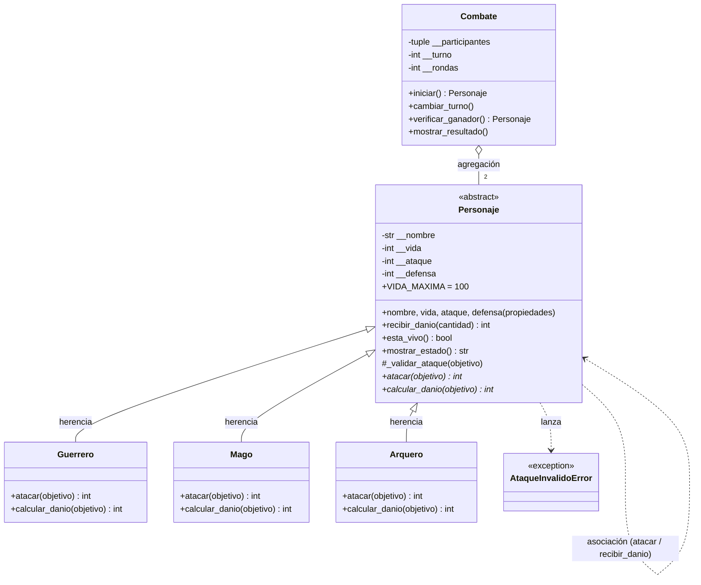

# Guardians of the Ancient Kingdom

Sistema de combate por turnos en Python, desarrollado con Programación Orientada a Objetos.

## 1. Descripción

En el reino de Eldoria existen tres órdenes de guardianes: **Guerreros**, **Magos** y **Arqueros**. Todos tienen nombre, vida, ataque y defensa, pero cada uno ataca de forma distinta.

El programa resuelve el problema de enfrentar a dos guardianes y decidir automáticamente quién gana: calcula el daño según la habilidad de cada orden, controla los turnos, actualiza la vida (sin permitir valores imposibles) y termina el combate cuando alguien es derrotado o cuando hay empate.

## 2. Estructura

```text
Guardians-of-the-Ancient-Kingdom/
├── personajes.py        # Definición de las clases (no ejecuta nada al importarse)
├── main.py              # Creación de objetos y los 12 casos de prueba obligatorios
├── test_personajes.py   # Pruebas automatizadas con Pytest (Reto 2)
└── README.md            # Documentación
```

- **`personajes.py`**: contiene `Personaje` (abstracta), `Guerrero`, `Mago`, `Arquero`, `Combate` y la excepción `AtaqueInvalidoError`.
- **`main.py`**: importa las clases, crea personajes, ejecuta ataques y combates y muestra los resultados de cada caso. No repite ninguna implementación.
- **`test_personajes.py`**: pruebas repetibles que verifican las reglas sin revisar mensajes a ojo.

## 3. Clases

| Clase | Responsabilidad |
|---|---|
| `Personaje` | Clase abstracta. Guarda y valida nombre, vida, ataque y defensa; sabe recibir daño, decir si está vivo y mostrar su estado. Obliga a las hijas a implementar `atacar()` y `calcular_danio()`. |
| `Guerrero` | *Golpe poderoso*: ataque +20 % antes de restar la defensa del objetivo. |
| `Mago` | *Hechizo penetrante*: su daño es igual a su ataque, ignorando la defensa. |
| `Arquero` | *Disparo crítico*: si su ataque supera la defensa del objetivo, el daño convencional se duplica; si no, el daño es 0. |
| `Combate` | Administra los turnos entre dos personajes: alterna atacantes, muestra el estado tras cada ataque, detecta al ganador y declara empates. |

## 4. Relaciones

- **Herencia (es un):** `Guerrero`, `Mago` y `Arquero` *son* un `Personaje`. Se usó para no repetir nombre, vida, ataque, defensa ni la lógica de recibir daño en tres clases.
- **Asociación (usa):** cuando `atacante.atacar(objetivo)` se ejecuta, ambos objetos interactúan: el atacante consulta la defensa del objetivo y le llama a `recibir_danio()`. Ninguno es dueño del otro; solo colaboran mediante sus métodos.
- **Agregación (tiene):** `Combate` *tiene* dos personajes que fueron creados fuera de él y recibidos en el constructor. Si el combate desaparece, los personajes siguen existiendo (se puede reutilizar a Arthas en otro combate).

## 5. Conceptos de POO en el programa

- **Abstracción:** `Personaje` hereda de `ABC` y declara `atacar()` y `calcular_danio()` con `@abstractmethod`. No se puede crear un "personaje genérico" (el caso 1 de `main.py` lo comprueba), solo guardianes concretos.
- **Encapsulamiento:** los atributos se guardan con doble guion bajo (`self.__vida`, etc.) y solo se acceden mediante propiedades (getters/setters) que validan: nombre no vacío, vida entre 0 y 100, ataque positivo, defensa no negativa. Los datos inválidos lanzan `ValueError` o `TypeError`.
- **Herencia:** las subclases reciben el constructor, las propiedades, `recibir_danio()`, `esta_vivo()` y `mostrar_estado()` sin reescribirlos.
- **Polimorfismo:** en `Combate.iniciar()` se ejecuta `atacante.atacar(objetivo)` sin preguntar si el atacante es Guerrero, Mago o Arquero; cada objeto responde con su propia habilidad.

## 6. Lógica del combate

**Cálculo del daño** (siempre se redondea hacia abajo, usando enteros para evitar errores de coma flotante):

| Orden | Fórmula |
|---|---|
| Guerrero | `max(0, ataque × 120 // 100 − defensa_objetivo)` |
| Mago | `ataque` |
| Arquero | `(ataque − defensa) × 2` si `ataque > defensa`, de lo contrario `0` |

Luego `recibir_danio()` descuenta ese valor (sin restar otra vez la defensa), la vida nunca baja de 0 y se devuelve el **daño efectivo** realmente recibido.

**Validaciones de ataque** (`_validar_ataque`): el objetivo debe ser un `Personaje`, no puede ser el mismo atacante, y tanto atacante como objetivo deben estar vivos; de lo contrario se lanza `AtaqueInvalidoError`.

**Turnos:**
1. Una ronda son dos ataques: primero `personaje1`, después `personaje2` (`cambiar_turno()` alterna entre ambos).
2. Tras cada ataque se imprime el estado de los dos.
3. Si alguien llega a 0 de vida, el combate termina de inmediato (el derrotado no ataca) y `verificar_ganador()` devuelve al vencedor.
4. Si una ronda completa termina sin ningún daño → **empate técnico**.
5. Si se completan 50 rondas sin ganador → **empate**.

## 7. Ejecución

Requisitos: Python 3.8+ (Pytest solo para las pruebas automatizadas).

```bash
git clone https://github.com/<tu-usuario>/Guardians-of-the-Ancient-Kingdom.git
cd Guardians-of-the-Ancient-Kingdom
python main.py
```

> Reemplaza `<tu-usuario>` por tu usuario de GitHub.

## 8. Pruebas

`python main.py` ejecuta los 12 casos obligatorios y muestra `[OK]` o `[FALLÓ]` en cada comprobación. Resultados obtenidos (ninguna comprobación falló):

| # | Caso | Resultado |
|---|---|---|
| 1 | Creación de Guerrero, Mago y Arquero; `Personaje` no es instanciable | OK |
| 2 | Vida 101 y −5 rechazadas (`ValueError`) | OK |
| 3 | Nombres `''` y `'   '` rechazados | OK |
| 4 | Ataque 0, negativo, texto y defensa negativa rechazados | OK |
| 5 | Guerrero (30 vs def. 10) causa **26** | OK |
| 6 | Mago (40 vs def. 20) causa **40** | OK |
| 7 | Arquero (35 vs def. 15) causa **40**; si no supera la defensa causa 0 | OK |
| 8 | 50 de daño sobre 20 de vida → vida 0 y daño efectivo 20 | OK |
| 9 | Un derrotado no puede atacar ni ser atacado; objetivo `None` rechazado | OK |
| 10 | Combate completo Arthas vs Gandalf (coincide con la tabla del enunciado) | OK |
| 11 | Ganador: **Gandalf** (Arthas 0, Gandalf 2) | OK |
| 12 | Dos arqueros con ataque 10 y defensa 50 → empate técnico en la ronda 1 | OK |

Fragmento de la salida del caso 10:

```text
--- Ronda 3 ---
Arthas ataca a Gandalf y causa 26 de daño.
  Arthas (Guerrero) - Vida: 20 | Ataque: 30 | Defensa: 20 | vivo
  Gandalf (Mago) - Vida: 2 | Ataque: 40 | Defensa: 10 | vivo
Gandalf ataca a Arthas y causa 20 de daño.
  Arthas (Guerrero) - Vida: 0 | Ataque: 30 | Defensa: 20 | derrotado
  Gandalf (Mago) - Vida: 2 | Ataque: 40 | Defensa: 10 | vivo

Ganador: Gandalf (en 3 rondas)
```

---

## Reto 1 — Diagrama de clases UML

Un **diagrama de clases UML** es un plano del programa: muestra cada clase con sus atributos y métodos, y cómo se relacionan (herencia, asociación, agregación). Sirve para entender y comunicar el diseño antes —o después— de programar. En UML, el nombre en *cursiva* indica clase/método abstracto, `-` es privado, `+` público y el rombo vacío (`o--`) indica agregación.



**Explicación:** `Personaje` es la clase abstracta (con `atacar()` y `calcular_danio()` abstractos). Las tres subclases heredan de ella y están obligadas a implementarlos. `Combate` agrega exactamente dos `Personaje` que existen independientemente. La flecha punteada de `Personaje` a sí mismo representa la asociación: un personaje usa a otro al atacar.

---

## Reto 2 — Pruebas automatizadas con Pytest

**Pytest** es un framework de pruebas para Python. Cada función `test_*` verifica una regla con `assert` (o con `pytest.raises` para comprobar que se lanza una excepción esperada). Al ejecutarlo, descubre las pruebas solo y reporta cuáles pasan o fallan, de forma repetible: si alguien rompe una regla al modificar el código, la prueba falla enseguida.

Instalación y ejecución:

```bash
pip install pytest
pytest -v
```

Resultado obtenido:

```text
============================= test session starts ==============================
collected 25 items

test_personajes.py::test_creacion_valida_de_los_tres_tipos PASSED        [  4%]
test_personajes.py::test_personaje_es_abstracto PASSED                   [  8%]
test_personajes.py::test_vida_fuera_de_rango[-1] PASSED                  [ 12%]
test_personajes.py::test_vida_fuera_de_rango[101] PASSED                 [ 16%]
test_personajes.py::test_vida_fuera_de_rango[1000] PASSED                [ 20%]
test_personajes.py::test_nombre_vacio[] PASSED                           [ 24%]
test_personajes.py::test_nombre_vacio[   ] PASSED                        [ 28%]
test_personajes.py::test_ataque_invalido[0] PASSED                       [ 32%]
test_personajes.py::test_ataque_invalido[-5] PASSED                      [ 36%]
test_personajes.py::test_defensa_negativa PASSED                         [ 40%]
test_personajes.py::test_tipos_incorrectos PASSED                        [ 44%]
test_personajes.py::test_setters_validan PASSED                          [ 48%]
test_personajes.py::test_dano_guerrero PASSED                            [ 52%]
test_personajes.py::test_guerrero_redondea_hacia_abajo PASSED            [ 56%]
test_personajes.py::test_dano_mago_ignora_defensa PASSED                 [ 60%]
test_personajes.py::test_dano_arquero_critico PASSED                     [ 64%]
test_personajes.py::test_arquero_sin_dano_si_ataque_no_supera_defensa PASSED [ 68%]
test_personajes.py::test_vida_nunca_negativa PASSED                      [ 72%]
test_personajes.py::test_danio_negativo_rechazado PASSED                 [ 76%]
test_personajes.py::test_derrotado_no_puede_atacar PASSED                [ 80%]
test_personajes.py::test_no_se_puede_atacar_a_derrotado_ni_a_none PASSED [ 84%]
test_personajes.py::test_combate_ejemplo_del_enunciado PASSED            [ 88%]
test_personajes.py::test_combate_empate_tecnico PASSED                   [ 92%]
test_personajes.py::test_combate_requiere_personajes_distintos_y_validos PASSED [ 96%]
test_personajes.py::test_cambiar_turno_alterna PASSED                    [100%]

============================== 25 passed in 0.05s ==============================
```

Las pruebas cubren: creación válida, rechazo de valores incorrectos, daño de cada clase, vida nunca negativa, derrotado que no ataca y resultado correcto del combate.

---

## Reto de abstracción

**¿Por qué `atacar()` debe ser abstracto, pero `recibir_danio()` puede estar implementado en la clase base?**

**Responsabilidad de `Personaje`.** La clase base representa lo que *cualquier* guardián es y puede hacer sin importar su orden: tiene un nombre, una vida acotada entre 0 y 100, un ataque y una defensa, puede recibir daño, estar vivo o derrotado y mostrar su estado. No sabe cómo pelea un guerrero en particular; solo define el contrato de que todo guardián *debe* poder atacar.

**Por qué `atacar()` es abstracto.** Atacar es lo único que cambia de una orden a otra. En mi programa, ante el mismo objetivo con defensa 10: el `Guerrero` con ataque 30 calcula `30 × 120 // 100 − 10 = 26`; el `Mago` con ataque 40 ignora la defensa y causa `40`; el `Arquero` con ataque 35 y defensa enemiga 15 calcula `(35 − 15) × 2 = 40`. Son tres fórmulas distintas, así que `Personaje` no puede escribir una implementación que sirva para todos: si lo hiciera, tendría que preguntar "¿eres Guerrero, Mago o Arquero?" con `if`, y cada nuevo guardián obligaría a modificar la clase base. Al declararlo `@abstractmethod`, Python impide crear un `Personaje` genérico (el caso 1 de `main.py` lo demuestra con un `TypeError`) y obliga a cada hija a definir su propio ataque.

**Por qué `recibir_danio()` sí puede implementarse en la base.** Recibir daño es igual para todos: llega una cantidad ya calculada (la defensa ya se descontó al calcular el daño), se rechazan cantidades negativas, la vida baja pero nunca por debajo de 0 y se devuelve el daño efectivo. Un Mago con 20 de vida que recibe 50 queda en 0 y devuelve 20, exactamente igual que un Guerrero o un Arquero (caso 8). Como esta lógica es idéntica, escribirla una sola vez en `Personaje` evita duplicar código en tres clases, y además mantiene la protección de la vida (`__vida`) en un único lugar: si hubiera un error en la regla "la vida nunca es negativa", se corrige una vez y se arregla para todos.

**Relación con abstracción, herencia y polimorfismo.**
- *Abstracción:* `Personaje` expone qué debe hacer todo guardián (`atacar`) y deja el cómo a cada subclase.
- *Herencia:* lo común (`recibir_danio`, `esta_vivo`, `mostrar_estado`, las validaciones) se reutiliza; lo particular (`atacar`) se especializa.
- *Polimorfismo:* `Combate.iniciar()` llama a `atacante.atacar(objetivo)` sin conocer el tipo concreto; cada objeto responde con su habilidad. Por eso se puede añadir, por ejemplo, un `Sanador` o un `Paladin` heredando de `Personaje` e implementando solo `atacar()`, **sin tocar una línea de `Combate`**.

En resumen: lo que *varía* se declara abstracto y se deja a las hijas; lo que *permanece igual* se implementa una vez en la base.
